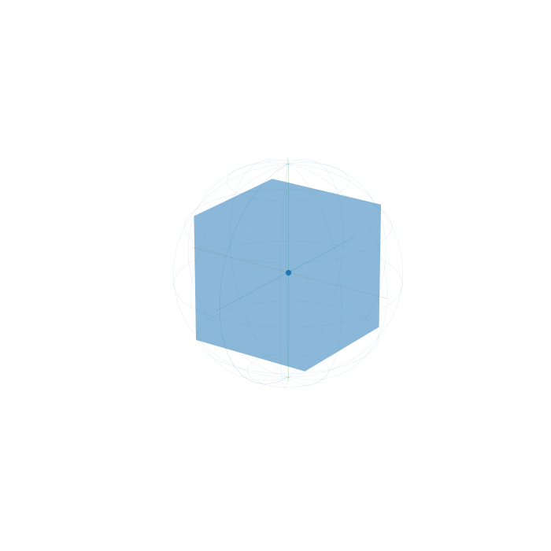

# Rotational K-D Tree

So I was mindlessly, listlessly, doomscrolling on Youtube when I encountered [this](https://www.youtube.com/shorts/AN0XXpZXqU0) (or rather it encountered me after surfacing in my recommended activity feed). Got me thinking (as I'm prone to do):

1. Can **Quadtrees** be extended to the three dimensions? A forest of Quadtrees ("forests" of tree-graphs are a useful metaphor in many famous algorithms).
1. Can we exploit something like **Polar Coordinates** (or, better [paths](./000000000138) on the surface of a **Sphere**) to help optimize or fix the projected quadrant that some piece of data would reside in?
1. How efficiently can we reuse data by rotating or transforming data within a "Cubetrees"?

## Initial Thoughts

> So, I learned about **KD-**, and **Ball Trees** but didn't really find anything about using three-dimensional **K-D Tree** within a **Sphere** (whose corners intersect the surface of the **Sphere**). Might just be ignorant here.

There are some probably fairly mundane observations here (but maybe not so obvious to me):
1. The **Rotational Group** for the interior **Cube** (being rotated in every which way about the same origin) forms the same enclosing **Sphere**.
1. That **Rotational Group** in turn appears to be akin a **Linked List** and can be potentially thought of as such.
1. If so, then there are some potential advantages. 
    * We can build a metaphorical **K-D Tree** *forest* out of a *single* three-dimensional **K-D Tree**.
    * We could potentially use **Polar Coordinates** to fix which **Rotation** we intend to use.
    * We can potentially embed into those **Polar Coordinates** a cipher or other data transformation function to have the original **Cube** do multiple-duty - reusing a finite data set in an infinite number of useful ways (think of an **Alphabet** with a fix number of charcters that can be mapped to an infinite number of combinations resulting in words, sentences, phrases).
    * These need not be **Polar Coordinates** alone, they can be a path to allow greater flexibility in retrieving and encoding data.

I had ChatGPT generate a GIF since I couldn't find one to illustrate this point:



## Some Nascent Research

So, apparently the consensus is:
* "Standard axis-aligned k-d trees are not naturally suited for the curved surface of a sphere because their straight, axis-aligned splitting hyperplanes cannot cleanly handle polar coordinate wraparound or spherical geometry."
"Spatial partitioning trees such as the kd-tree [4–6], quadtrees and higher dimensional variants [7], and vp-trees [8] can efficiently handle exact nearest neighbor searching in lower dimensions. These structures generally perform well on data in a Euclidean metric space, but because of their partitioning mechanism (e.g., axis-aligned splits), they do not readily adapt to the rotational group
SO(3)." - https://robotics.cs.unc.edu/publications/Ichnowski2014_WAFR.pdf
* "...there has to be a unique ordering on the points to determine the resulting k-d tree uniquely." - https://arxiv.org/pdf/1903.04936/1000
* https://faculty.cc.gatech.edu/~vempala/papers/kdtrees.pdf

The upshot:  **KD-Trees** are cutting edge as of 2026 and academics are working to overcome certain limiting properties to enhance their utility. Projecting a **KD-Tree** onto the surface of a Sphere is an active subtopic but there seems to be little in the way of considering **KD-Trees** as a **Rotational (Symmetry?) Group** or affixing the orientation of a Euclidean rotated **KD-Tree** (about its origin) to a specific set of Spherical Coordinates.

> Of course this is all very quick. There's more to be researched and verified!

## Some Definitions and Properties

Before we get to some code:
* A **Cube**'s maximal **Rotational Symmetry Group** is the **Chiral Octahedral Group**. We probably want something with more *degrees of freedom* which is apparently something like a **Linear / Non-Rigid Ambient Group**.
* Can we treat each rotation of the same underlying data and **Cube** as a distinct data set?
* Each rotation can be represented or uniquely captured by a set of **Spherical Coordinates**. 
    * These can represent or be a **Hash**.
    * Serve as a **Linked List** (with the data of each Node being a specific **KD-Tree**).
    * It can serve as meta-data indicating the way to uniquely retreive the underlying data of the **KD-Tree** (which is an excellent and efficient data structure with many of the best (and better than the) characteristics of **Binary Search Trees**, **Cube Trees**, etc.)
* It's unclear to what extent the **Holographic Principle** rears up here. The **Projection**-based approaches I mentioned above can take many forms (a single **KD-Tree** projected onto a **Sphere**, etc.).
* How an we create a "Morphic Database"?
    * The **Query** is the invariant. As is the the Data.
    * The **Mutator** is the rotatability of the Data.

## AI Assist

I asked AI to help me write up a POC in python with perf tests.

I had to clarify, guide, coax, and inquire about:
* Hashing here means to use spherical coordinates and should be done AOT.
* To verify across multiple kinds of scenarios: characters, words, sentences, etc. 
* To define comparisons for performance testing - it had a hard time coming up viable comparison data structures/scenarios.
* To specifically request computations/equations around lower/upper bounds and Big O Time/Space Complexity.
* To define a relavent metaphor - it struggled somewhat until I stated something like "We should think of the query as an invariant. And the dataset but not the rotation."

> Below is the pretty stellar write-up that it eventually arrived at.

### Rotation-Key Paragraph Example

The demo builds one fixed dataset containing `A` through `Z`, space, and
period. Its world-space query `(0, 0, 1)` and indexed dataset remain invariant.
For each character in the paragraph, a rotation is represented by spherical
coordinates: rotation angle, axis azimuth, and axis inclination. That triple
is the orientation key (the "hash"). Applying the inverse orientation to the
fixed query lets the unchanged KD-Tree retrieve the character that a virtually
rotated dataset would bring to the query. The example prints every character
and its spherical key, then decodes the linked rotation path to verify the
full paragraph round trip: "THE QUERY STAYS FIXED. THE A TO Z DATASET
STAYS FIXED. ONLY THE SPHERICAL ROTATION KEY CHANGES." Each printed record
shows the character and its exact spherical-coordinate hash values.

This representation pins a sequence relative to this particular dataset,
tree, and query; it is not encryption or compression. The transformed points
are conceptual: the implementation does not mutate the query or rebuild or
rotate the indexed dataset.

The demo precomputes one canonical orientation key for each supported
character before encoding (AOT: ahead of time). Encoding then reuses those
keys instead of solving the character-to-rotation alignment for every
occurrence. The performance test reports the one-time key-table build cost,
on-demand versus precomputed encoding time, and the number of repeated
encodings needed to amortize precomputation for that measured message size.
This is useful when the same fixed alphabet/index is reused; for one short
message, include the table-build cost when comparing approaches.

### Word-to-Sentence Example and Complexity

The second performance suite uses a fixed dataset of distinct whole words
from `WORD_SENTENCE`, assigns each word a point in the same 3D space, and
encodes the sentence as a sequence of orientation keys. Decoding joins the
retrieved word values with spaces. It runs the same three lookup comparisons
as the character suite: Rotational KD-Tree, rotated-array scan, and uniform
grid/fixed spatial hash. Both suites also report on-demand versus AOT key
encoding separately from those lookup timings.

SciPy's `KDTree` indexes numeric coordinates rather than arbitrary strings;
the demo keeps an immutable value table in the same point-index order, so
each returned nearest-point index resolves to its associated character or
whole word.

For `n` indexed values, `m` orientation queries, and fixed three-dimensional
coordinates, the expected complexity of the Rotational KD-Tree path is:

| Operation | Expected time | Worst-case time | Additional space |
|---|---:|---:|---:|
| Build balanced KD-Tree | `O(n log n)` | Implementation-dependent | `O(n)` |
| Apply one inverse rotation | `O(1)` | `O(1)` | `O(1)` |
| One nearest-neighbor query | `O(log n)` | `O(n)` | `O(1)` |
| Decode `m` keys after tree build | `O(m log n)` | `O(mn)` | `O(m)` for the linked path |
| Build AOT keys for `n` values | `O(n)` | `O(n)` | `O(n)` |
| Encode `m` values with AOT keys | `O(m)` | `O(m)` | `O(m)` for the linked path |

Thus the typical build-plus-decode time is `O(n log n + m log n)`, with
`O(n + m)` total storage including the tree, AOT key table, and retained
rotation path. KD-Tree queries are logarithmic on average in low-dimensional
well-behaved data, not guaranteed: the nearest-neighbor search can visit all
`n` points in the worst case. The demo's on-demand encoder also searches the
value list for each input value; that direct list lookup adds `O(n)` per
encoded value. Precomputed dictionary keys avoid that repeated scan.

### Storage Break-Even and Uniform Grid Comparison

There is no finite capacity in the spherical-coordinate key itself: it stores
three floating-point rotation values per step. A useful storage comparison is
against retaining a full rotated copy of the point dataset for every
orientation. Let `N` be the number of points, `M` the number of orientations,
`P` the coordinate bytes per point, and `H` the bytes per orientation key
(24 bytes for three float64 values). Keeping the base dataset and the keys
uses `N*P + M*H` bytes; retaining all rotated snapshots uses `M*N*P` bytes.
The keys are smaller when:

```text
N*P + M*H < M*N*P
N > M*H / ((M - 1)*P), for M > 1
```

With one orientation (`M=1`), base plus key is always larger than one full
dataset snapshot. The storage advantage applies to retaining multiple full
snapshots, not to a rotate-and-scan implementation that creates one temporary
array at a time and discards it. These payload estimates also omit KD-Tree
index nodes, linked-list objects, and allocator overhead; measure resident
memory for a concrete implementation.

Concrete coordinate-payload examples with `P=24 B` and `H=24 B`:

| Points `N` | Orientations `M` | Base dataset + keys | Retained full snapshots |
|---:|---:|---:|---:|
| 1,000 | 100 | 26,400 B | 2,400,000 B |
| 100,000 | 1,000 | 2,424,000 B | 2,400,000,000 B |
| 1,000,000 | 100 | 24,002,400 B | 2,400,000,000 B |

There is no fixed hash-bucket capacity; instead, decoding precision must
preserve a nearest-point margin. If `epsilon` is the total angular/query error
and `delta_min` is the minimum angular separation between dataset points,
require `2*epsilon < delta_min`.

Both named performance suites compare a uniform grid (fixed spatial hash)
with the same invariant query and rotation sequence. The grid bins unchanged
points into fixed-size 3D cells and expands the search through neighboring
cells until it can prove no unvisited cell is closer. Expected lookup is near
`O(1)` when point density and cell size are well behaved, but the exact search
can degrade to `O(n)` point checks and depends on the number of visited cells.
The grid is an alternative index, not a different rotation-key representation.

## Resources and Links

1. https://www.geeksforgeeks.org/dsa/quad-tree/
1. https://www.geeksforgeeks.org/machine-learning/ball-tree-and-kd-tree-algorithms/
1. https://robotics.cs.unc.edu/publications/Ichnowski2014_WAFR.pdf
1. https://arxiv.org/pdf/1903.04936/1000
1. https://faculty.cc.gatech.edu/~vempala/papers/kdtrees.pdf
